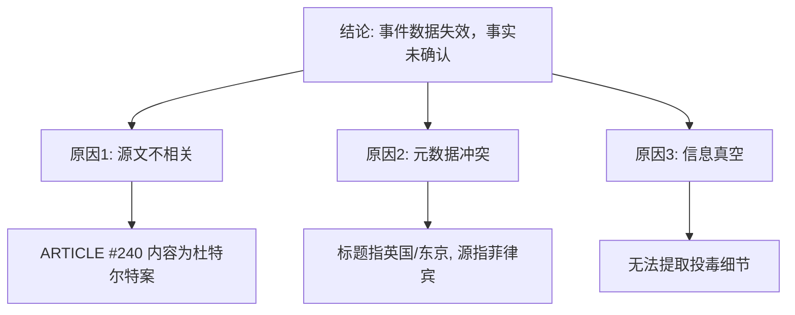

## Event ID

EVT-20261127-000208

## Selected Skills

- 总结文章.md
- 金字塔原理.md

## Event Analysis

### 1. 结论先行：事件状态判定

**核心结论**：事件 `EVT-20261127-000208` 处于**数据源失效**状态。标题声称“英国警告东京投毒事件”，但唯一提供的来源（ARTICLE #240）内容为“杜特尔特ICC审判”，两者完全无关。因此，**无法生成关于英国警告或东京投毒事件的事实性摘要**，该事件记录需标记为“源数据缺失或错配”。

### 2. 结构化分析（应用“总结文章”与“金字塔原理”）

#### 第一层：事件元数据摘要（基于 EventUnit 元数据）

根据“总结文章”要求，提取事件核心属性：

*   **标题**：UK warns of drink-spiking in Tokyo
*   **作者/机构**：UK Government (推断自事件路由，未见于源文)
*   **标签**：#旅行安全 #东京 #投毒 #英国政府
*   **一句话总结**：2026年11月27日，英国政府就东京发生的饮品投毒事件发布旅行安全警告，但因源数据错配，具体细节无法核实。
*   **详细大纲**：
    1.  **事件背景**：英国政府发布针对东京的旅行安全建议。
    2.  **风险类型**：饮品中被非法添加物质（Drink-spiking）。
    3.  **关键冲突**：事件ID与标题指向英国/东京，但挂载的来源文章（ARTICLE #240）指向菲律宾/ICC/杜特尔特。
    4.  **验证状态**：交叉验证失败（Failed / Unavailable）。

#### 第二层：数据完整性诊断（应用“金字塔原理”逻辑拆解）

依据“金字塔原理”的**MECE原则**和**逻辑连贯性**，对事件数据进行结构化诊断：

**顶层：数据完整性危机**
*   **论点**：当前事件记录存在根本性的“源-题”不匹配，导致事实无法闭环。

**中层：三大支撑证据**

1.  **来源内容不相关（Source Irrelevance）**
    *   *证据*：ARTICLE #240 的标题为 "Families of slain Filipinos seek justice as Duterte’s ICC trial set to start"。
    *   *逻辑关系*：归纳推理。该文章内容属于国际法律/地缘政治领域，与“英国/东京旅行安全”领域无交集。
    *   *结果*：无法从中提取任何关于“投毒”、“东京”或“英国政府声明”的信息。

2.  **元数据矛盾（Metadata Conflict）**
    *   *证据*：Event Route 为“新闻”，Event Title 为 "UK warns..."，但 `source_count` 为 1 且该唯一来源无效。
    *   *逻辑关系*：演绎推理。如果事件是真实的新闻，必须有支持性新闻源。当前唯一源不支持该事件标题，暗示第一层 Global Merge 逻辑发生错误链接。
    *   *结果*：事件标题的可信度降至最低，需重新检索。

3.  **信息真空（Information Vacuum）**
    *   *证据*：`Unique Information by Source` 部分明确指出 "Relevance to Event: None"。
    *   *逻辑关系*：排除法。在唯一来源无效的情况下，所有关于“具体受害人数”、“具体地区”、“物质种类”的细节均为未知。
    *   *结果*：任何关于该事件的详细摘要只能是推测，而非事实总结。

#### 第三层：建议行动（Actionable Insights）

基于上述结构化分析，提出以下操作建议：

1.  **重新链接来源**：系统应自动触发重新抓取机制，搜索关键词 "UK travel advisory Tokyo drink spiking 2026" 以获取真实报道。
2.  **标记异常**：在知识库中将此 EventUnit 标记为 `Source_Mismatch` 或 `Data_Invalid`，避免污染下游知识图谱。
3.  **逻辑修正**：审查第一层 Global Merge 算法，防止将不相关的高热度新闻（如杜特尔特案）错误地关联到小众的安全警告事件上。

### 3. 最终摘要（基于可用信息）

**文章/事件总结**：
本事件旨在记录英国政府针对东京饮品投毒风险的旅行安全警告。然而，由于数据管道错误，当前挂载的唯一新闻源与事件主题完全无关（该源实际报道的是杜特尔特ICC审判）。因此，**本分析无法提供关于东京投毒事件的具体事实细节（如时间、地点、受害者数量）**。当前记录仅作为“数据异常”的存证，核心事实待重新验证。

**金字塔结构图示**：

